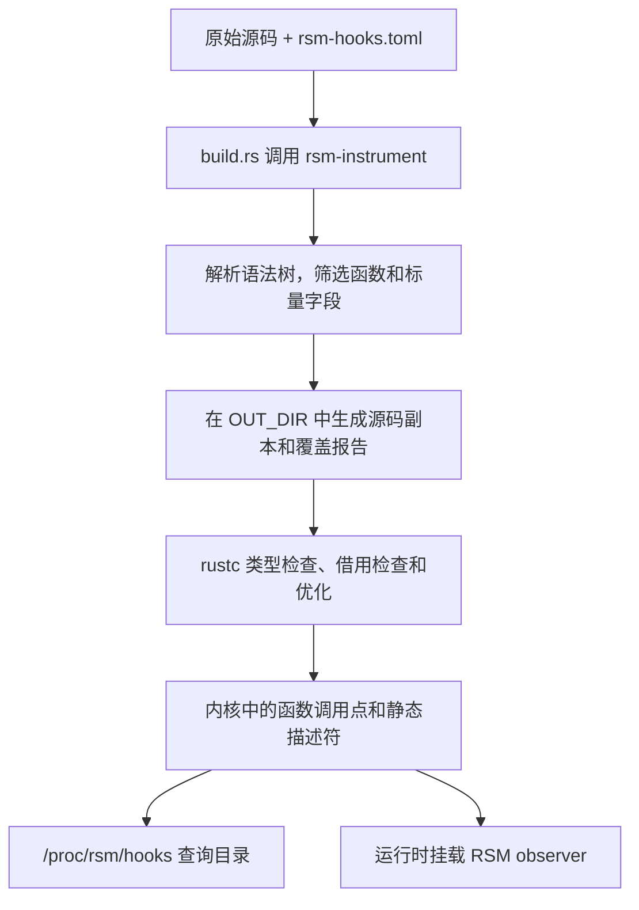

# RSM 函数 Hook：实现、使用与取舍

本实现为 Asterinas 中的 RSM 插件提供**编译期自动生成、运行时动态挂载**的函数 hook。
启用 `rsm-hooks` 后，构建工具为选定函数加入入口和正常返回两个观测点。
内核启动后，用户可以查询这些位置，并挂载或卸载插件，无需再次编译内核。

目标是满足 research paper case study 中“主要子系统的大部分函数可以观测”的需求。
它提供了接近原先 eBPF 式目标的动态挂载体验，
但使用自己的 RSM 原生产物和控制接口，不实现 Linux `bpf` ABI。
新增 hook 位置需要重新构建内核；已有位置上的插件可以在运行时更换。

本文对应当前工作区的实现。
具体覆盖数字来自 2026-11-12 的 x86-64 验证构建，不能视为所有架构和配置的固定承诺。
简要英文说明见 [RSM Function Hooks](rsm-function-hooks.md)。

## 1. 当前能观测什么

这里的 **hook point** 是预先生成在函数入口或正常返回路径上的位置。
**Observer** 是挂载到该位置的 RSM 插件。
原函数执行到这个位置时，运行时在允许的执行上下文中同步调用 observer。

当前覆盖 `aster-core` 的六个主要子系统：

| 子系统 | 验证构建中的函数 hook 数 |
| --- | ---: |
| 系统调用 | 433 |
| 文件系统 | 2,111 |
| 网络 | 628 |
| 进程管理 | 698 |
| 虚拟内存 | 216 |
| IPC | 47 |
| 合计 | 4,133 |

每个函数描述符包含 entry 和 return 两个独立的挂载位置。
表中的数字是函数数，不是两个阶段相加的数量，也不表示每次经过函数都一定执行回调。

例如，`aster_core::syscall::read::sys_read` 的观测内容是：

| 阶段 | 当前暴露的字段 | 未暴露的内容 |
| --- | --- | --- |
| Entry | `raw_fd`、`user_buf_addr`、`buf_len` | `ctx` 引用及其指向的内核对象 |
| Return | `is_error` | 读取字节数、具体 errno、返回对象内部字段 |

`sys_read` 的返回类型是 `Result<SyscallReturn>`。
生成器能判断是否为 `Err`，但不会自动展开 `SyscallReturn::Return`。
因此不能把它描述为“自动获取所有函数的完整参数和返回值”。
`sys_getpid` 也有同样限制：当前 return payload 不包含 PID。

这些 hook 用于观测，不提供修改原函数参数、替换返回值或跳过原函数的接口。
目前也没有任意指令地址、函数中间某一行或任意局部变量的探针。

## 2. 编译期如何生成 Hook

### 2.1 构建流程

实现采用 Rust 源码转换，而不是运行时修改机器指令，也没有维护 rustc 分支。



具体步骤如下：

1. `kernel/core/build.rs` 读取 `kernel/core/rsm-hooks.toml`。
2. `tools/rsm-instrument` 使用 `syn` 解析源码，挑选普通函数和实现块中的方法。
3. 工具将源码复制到 Cargo 的 `OUT_DIR/rsm-hook-src`，只对选中函数插入包装代码。
4. `kernel/core/src/lib.rs` 在启用 feature 时使用生成的六个模块根；关闭 feature 时继续使用原始模块。
5. 生成的源码像普通 Rust 一样经过类型检查、借用检查和优化，并可使用标准 Clippy 流程检查。

原始源码文件不被改写。
输出目录专供生成器使用，每次生成会重新创建内容，避免已删除或移动的模块残留。
已有输出树中的符号链接会被拒绝，输出文件也不会通过硬链接覆盖原始文件。

生成目录保留原来的模块层次。
`short-vis-path` 通过 `SHORT_VIS_PATH_GENERATED_ROOT` 识别这份副本，
继续按原模块层次计算可见性路径。
这项适配没有扩大原来声明的可见性。

### 2.2 为什么用立即调用的闭包

假设原函数如下：

```rust
fn checked_len(len: usize) -> Result<usize, ()> {
    if len == 0 {
        return Err(());
    }
    Ok(len)
}
```

生成后的核心逻辑可以简化为下面的形式。
这里省略了生成器用于避免命名冲突和处理 lint 的细节：

```rust
fn checked_len(len: usize) -> Result<usize, ()> {
    use aster_rsm::hooks::Field;

    let hook = aster_rsm::function_hook!(
        "checked_len",
        &[Field::new("len", "usize")],
        &[Field::new("is_error", "bool"), Field::new("ok", "usize")]
    );
    let invocation = hook.enter([len as u64, 0, 0, 0]);
    let result = (move |len: usize| -> Result<usize, ()> {
        if len == 0 {
            return Err(());
        }
        Ok(len)
    })(len);
    invocation.finish([
        u64::from(result.is_err()),
        match &result {
            Ok(value) => *value as u64,
            Err(_) => 0,
        },
        0,
        0,
    ]);
    result
}
```

原函数体内的提前 `return`、`?`，以及宏展开产生的返回，都会先从闭包返回，
然后经过统一的 `finish`。
因此不需要逐一改写每条返回语句。
原有嵌套闭包和嵌套函数仍保留自己的返回边界。

参数被显式转交给闭包，而不是仅依赖闭包按使用情况捕获。
方法的 receiver 则作为整体捕获，避免按字段捕获改变拥有所有权的 `self` 的析构顺序。
局部变量和未转移到返回值中的参数，在 return observer 前按原有顺序析构。
已经转移给返回值的对象继续由返回值持有。

**正常返回不等于成功返回。**
`Err(...)` 和由 `?` 触发的错误返回也会经过 return hook。
Panic、abort、成功后不再返回的执行路径，不会产生正常返回事件。

### 2.3 描述符与字段

每个函数的 `function_hook!` 声明一个静态 `Hook`，通过 `inventory` 收集。
描述符无需等到函数第一次执行才出现，因而启动后就可以枚举和挂载。
描述符包含函数名、ID、两阶段的字段描述，以及挂载状态和统计计数。

运行时名称由 `module_path!()` 与函数或方法后缀组成。
ID 是名称的 64 位 FNV-1a 哈希；查询遇到重复 ID 时会拒绝模糊匹配。
ID 不是跨版本 ABI，重建后应重新读取目录。
泛型函数的不同实例共享定义对应的描述符，不按具体类型参数分别挂载。

生成器识别的标量类型包括：

- `u8` 到 `u64`、`i8` 到 `i64`、`usize`、`isize`；
- `bool`、`char`；
- 当前明确列出的整数别名 `Vaddr`、`RawFileDesc`、`Pid`、`Tid`。

Entry 按参数声明顺序选取最多四个可识别的标量字段。
Receiver、引用、复杂对象和超出容量的参数会被省略，并写入报告。
这不是完整的 Rust 类型解析：新的别名或不同的类型写法不一定自动获得相同字段支持。

Return 的字段规则是：

| 返回类型 | Payload |
| --- | --- |
| 可识别标量 `T` | `return` |
| `Result<T, E>`，且 `T` 是可识别标量 | `is_error`、`ok`；错误时 `ok = 0` |
| `Result<T, E>`，但 `T` 是复杂对象 | 只有 `is_error` |
| 其他可插桩的返回类型 | 无返回字段，仍可统计回调次数 |

裸指针类型不导出，引用也不会跨过原函数体保存在 hook token 中。
但 `Vaddr` 本身是整数地址值，会按整数复制；不能据此声称事件中完全没有地址数值。
Hook 接口只传递数值，不另外提供类型化对象访问 API；
原生代码的内存访问仍依赖下文说明的信任假设。

## 3. 运行时执行与生命周期

### 3.1 一次函数调用的流程

1. `Hook::enter` 先读取启用标志；没有 observer 时立即返回空 token。
2. 有 observer 时，检查是否处于普通任务上下文，并尝试读取挂载状态。
3. 保存 entry observer 的临时引用，以及 return attachment 的代数编号。
4. 释放挂载锁，按执行条件调用 entry observer。
5. 运行原函数体，期间不持有 hook 锁、中断／抢占 guard 或插件 `Arc`。
6. 原函数正常返回后，重新检查执行条件和 return attachment 的代数，再决定是否调用 return observer。

**代数编号（generation）**是每次成功挂载时分配的新编号。
它用来区分同一位置上先后安装的 observer，避免旧函数调用错误地通知新插件。
通过入口准入检查后还会分配一个 `invocation_id`，用于关联同一次调用的 entry 和 return。
这两个编号都不会回绕后复用；耗尽时拒绝相应操作或观测。

运行时仅在 x86-64 的普通任务上下文执行原生 observer。
以下情况会跳过回调：

- 启动阶段尚无当前任务，或处于中断／原子上下文；
- 挂载状态锁正在被占用，无法立即获得读锁；
- 原生调用所需栈空间不足；
- Return attachment 已卸载或已经换成另一代。

栈检查使用 artifact 声明的原生栈峰值，再加上 16 KiB 调用路径预留。
真正执行插件时会禁止本地中断和抢占，防止执行期间迁移或占用已检查的栈余量。
插件执行中再次经过被插桩函数时，嵌套 observer 会因原子上下文而跳过。
这些 guard 只覆盖回调，不覆盖原函数，因此原函数仍可以正常阻塞、调度和迁移。

Entry 和 return **不保证成对出现**。
例如进入函数时尚未挂载 return observer，之后再挂载，也不会补发这次调用的返回事件。
如果某阶段的栈检查失败，另一个阶段仍可能执行。
`invocation_id` 提供关联依据，但不能当作事件不会遗漏的保证。

### 3.2 卸载和替换期间发生什么

以阻塞的 `sys_read` 为例：

```text
进入 sys_read：记住 return attachment 的 generation = 7
sys_read 等待数据
控制端卸载旧 observer，挂载新 observer：generation = 8
sys_read 被唤醒并返回：发现代数不同，跳过这次 return 回调
下一次 sys_read：可以正常使用 generation = 8
```

函数体运行期间只保留描述符、调用 ID 和代数，不持有插件的代码所有权。
因此长时间阻塞的调用不会一直占着旧插件的 `Arc`。
已经取得插件引用的回调则可以在 detach 后执行完毕，
其临时 `Arc` 保证代码映射在执行期间仍有效。
**Detach 不等待所有已经取得引用的回调结束。**

控制状态是系统全局的：

- 每个函数的每个 phase 最多挂载一个 observer；同一个程序可挂到多个位置。
- `LOAD` 替换供后续 attach 使用的当前程序槽，不替换已经挂载的程序。
- 控制进程退出不会自动 detach；需要显式清理自己安装的挂载。
- 当前没有单独的 unload 命令；detach 也不会清空当前程序槽。
- 没有内建的按进程隔离的 attachment handle 或 PID 过滤接口。

### 3.3 安全边界

新增的 hook runtime 和生成的内核代码使用 safe Rust。
执行上下文和栈边界查询位于 OSTD，读取栈指针所需的底层代码也位于 OSTD。

但当前分支继承的 RSM native adapter 仍含有原有的 `unsafe` 调用边界。
Loader 会解析、重定位 artifact 并检查声明值，
**不会在加载时验证机器码安全性，也不会验证签名**。
它依赖可信的外部编译／验证过程及可信的产物传递。
`CAP_SYS_MODULE` 是访问控制，不是不可信插件的安全沙箱。

因此论文中应分别描述“新增 hook 机制使用 safe Rust”和“原生插件执行所依赖的信任假设”，
不能把两者合并成整个原生加载链路已由 Rust 类型系统保证安全的结论。

## 4. 如何使用

### 4.1 编译并启动

以下开发命令均在项目开发容器内、仓库根目录执行：

```sh
make kernel FEATURES=rsm-hooks
make run_kernel FEATURES=rsm-hooks
```

只在 guest 内执行目录查询和 RSM 控制 syscall。
挂载操作需要初始 user namespace 中的 `CAP_SYS_MODULE`。

### 4.2 查询目标函数

```sh
cat /proc/rsm/hooks
awk -F '\t' '$2 == "aster_core::syscall::read::sys_read"' /proc/rsm/hooks
```

目录按制表符分为四列：

```text
# id    function    entry_fields    return_fields
```

第一列是十六进制 ID；字段写成 `名称:类型`，多个字段用逗号分隔，无字段时为 `-`。
目录在本次启动期间不可变，所以分段读取不会因为并发 attach／detach 混入另一份目录。
程序应从当前 guest 目录解析 ID，不要把上一次构建的 ID 写死。

构建报告与运行时目录有不同用途：

| 数据 | 用途 |
| --- | --- |
| 构建日志给出的 `rsm-hooks-report.json` | 查看源码候选、跳过原因、实际导出字段和省略参数 |
| `/proc/rsm/hooks` | 查询经过 `cfg` 和实际构建后，当前内核可挂载的函数 |

报告中的函数名按源码路径生成；使用 `#[path]` 等重定向时可能与运行时模块名不同。
查找实际挂载点时，以运行时目录为准。

### 4.3 准备插件和事件 ABI

需要准备当前 RSM loader 支持的可信原生 artifact；入口名为 `main`。
直接加载 Rust 源文件、普通共享库或 Linux eBPF 字节码不属于这个接口。
回归程序 `test/initramfs/src/regression/rsm/function_hooks_test.c`
保留了编译好的 v1 测试插件，也可以加载从 Rust 源码编译的 v2 插件。
v2 插件可以携带字符串等只读数据。加载器按编译器给出的偏移完成重定位，
将代码页设为可读、可执行，将数据页设为只读、不可执行。

函数 hook 传给入口的七个 `u64` 槽位依次为：

| 槽位 | 含义 |
| --- | --- |
| 0 | `hook_id` |
| 1 | `phase`：0 为 entry，1 为 return |
| 2 | `invocation_id` |
| 3—6 | 当前阶段的最多四个 payload 值，未使用的槽位补零 |

有符号整数按 Rust `as u64` 的规则转换。
插件应结合目录中的字段类型解释这些值。
这个布局复用了原来的七槽调用通道，但含义不同于旧 syscall observer 的“syscall number + 六个参数”。
旧插件能否复用，取决于它如何解释这些槽位，不能只看入口签名相同。

### 4.4 加载、挂载、读取统计和卸载

控制接口为 `syscall(500, cmd, arg1, arg2)`：

| `cmd` | `arg1` | `arg2` | 操作 |
| ---: | --- | --- | --- |
| 0 | Artifact 字节指针 | 字节数，最多 1 MiB | 加载并替换当前程序槽 |
| 1 | 忽略 | 忽略 | 挂载旧 syscall 入口 observer |
| 2 | 忽略 | 忽略 | 卸载旧 syscall 入口 observer |
| 3 | 旧统计结构指针 | 忽略 | 读取旧接口的程序 counter 和调用统计 |
| 4 | Hook ID | Phase | 将当前程序挂到指定函数阶段 |
| 5 | Hook ID | Phase | 卸载指定函数阶段 |
| 6 | `rsm_hook_stats` 指针 | 忽略 | 读取指定阶段的累计统计 |

命令 0、1、2、4、5 需要 `CAP_SYS_MODULE`，3 和 6 不要求该 capability。
函数 hook 不需要先调用旧命令 1；命令 2 也不会卸载函数 hook。

下面的片段展示调用顺序，假设 `artifact`、`artifact_size` 和 `hook_id` 已经准备好。
实际控制程序必须检查每次调用的返回值，并在失败路径清理已经成功安装的阶段；
现有回归测试提供了完整示例。

```c
/* 加载可信产物；此时还没有给函数安装 observer。 */
syscall(500, 0, (uintptr_t)artifact, artifact_size);

/* 两个阶段独立安装，也可以只安装一个。 */
syscall(500, 4, hook_id, 0);
syscall(500, 4, hook_id, 1);

/* 执行需要观测的工作负载，然后分别卸载。 */
syscall(500, 5, hook_id, 0);
syscall(500, 5, hook_id, 1);
```

命令 6 使用以下 C 布局：

```c
struct rsm_hook_stats {
    uint64_t hook_id;
    uint32_t phase;
    uint32_t reserved;
    uint64_t invocations;
    uint64_t skipped;
    uint64_t traps;
};

struct rsm_hook_stats stats = {
    .hook_id = hook_id,
    .phase = 1,
    .reserved = 0,
};
if (syscall(500, 6, (uintptr_t)&stats, 0) == -1) {
    /* 处理 errno。 */
}
```

`reserved` 必须为零。
三个计数器的含义是：

| 字段 | 含义 |
| --- | --- |
| `invocations` | 已开始的 native observer 调用数，包括后来返回 trap 状态的调用 |
| `skipped` | 因上下文、锁、栈或旧 return generation 等原因被拒绝的观测尝试 |
| `traps` | Native 调用返回非零状态的次数，不代表捕获了所有硬件故障或超时 |

计数器属于函数阶段，从启动以来累计，重新挂载不会归零；溢出时回绕。
并发读取是近似快照，实验时应比较工作负载前后的差值。
完全没有挂载的阶段不会仅因函数经过而增加 `skipped`。
若函数入口准入检查失败，会对当时已启用的阶段分别计一次跳过；
因此 `skipped` 不能直接解释为“实际发生但未上报的正常返回次数”。

常见错误如下：

| 错误 | 常见原因 |
| --- | --- |
| `ENOENT` | ID 不存在、尚无已加载程序，或卸载一个未挂载的阶段 |
| `EBUSY` | 该函数阶段已有 observer，需先卸载 |
| `EINVAL` | Phase 不是 0／1、统计结构的保留字段非零、ID 存在歧义，或 artifact 无效 |
| `EOVERFLOW` | 挂载代数已经耗尽 |

### 4.5 调整生成范围

修改 `kernel/core/rsm-hooks.toml`，例如只保留 syscall 和 VFS 相关函数：

```toml
include = ["syscall/**", "fs/**"]
exclude = ["syscall/rsm.rs", "fs/fs_impls/procfs/rsm/**"]
functions = ["syscall::*", "fs::vfs::*"]
exclude_functions = []
```

路径相对于 `kernel/core/src`；函数模式匹配报告中的源码限定名，不加 `aster_core::` 前缀。
这里的 `*` 匹配任意字符序列，包括 `/`，不是完整的 shell glob 语法。
排除规则优先。

只想检查生成代码时，可以运行：

```sh
cargo run --manifest-path tools/rsm-instrument/Cargo.toml -- \
    kernel/core/src /tmp/rsm-hook-preview kernel/core/rsm-hooks.toml
```

`/tmp/rsm-hook-preview` 必须是专用输出目录，其已有内容会被重新生成。
CLI 的报告名是输出目录中的 `rsm-hooks.json`；内核 build script 使用 `rsm-hooks-report.json`。

当前模块接线固定为 `fs`、`ipc`、`net`、`process`、`syscall`、`vm` 六个根。
若要扩展到 `sched` 等其他模块，仅修改 `include` 不够，
还需要调整 `build.rs` 和 `lib.rs` 的模块接线，并验证执行上下文。
OSTD、hook runtime 和 RSM 管理／目录查询路径不在默认插桩范围内。

## 5. 实现取舍

### 5.1 主要设计选择

| 选择 | 得到的能力或简化 | 代价与限制 |
| --- | --- | --- |
| 构建期生成 safe Rust | 大量函数无需手写 hook；生成结果仍接受 Rust 检查；无需维护编译器分支 | 只能挂到本次构建已生成的位置，无法对已有内核临时增加任意指令点 |
| 函数入口／正常返回 | 覆盖统计、路径观测、错误率等常见 case study；实现和验证边界明确 | 不包含函数中间状态；panic 和不返回路径没有 return 事件 |
| 每阶段最多四个标量 | 不跨函数体保留对象借用，避免暴露任意内核对象访问接口 | 复杂对象、任意别名和内部返回枚举需要额外设计字段适配 |
| 只在普通任务上下文执行 | 能控制重入、栈余量和代码回收条件 | 覆盖目录中的函数，也可能因调用上下文而跳过 observer |
| 回调期间禁止中断和抢占 | 稳定执行 CPU 和已检查的栈条件，阻止递归 observer | 插件应短小且有界；长回调会增加中断和调度延迟 |
| Return 使用 generation，函数体不持有插件 `Arc` | 阻塞调用不长期持有旧代码，不会把旧调用发给新插件 | Detach／reattach 期间可以缺失 return；不提供完整无损调用配对 |
| 全局控制槽，每阶段一个 observer | 控制面简单，可复用现有 RSM loader | 无 attachment handle、自动进程清理、多 observer 列表或独立 unload 接口 |
| 保留可信原生插件模型 | 可复用现有 RSM 编译产物和执行路径 | 没有新增加载时 verifier、签名验证或恶意代码隔离能力 |

关闭 `rsm-hooks` 时使用原始源码模块。
打开 feature 但不挂载插件时，运行时有基于启用标志的快速返回，
但插入的包装、字段准备、代码和元数据仍可能带来开销。
不能把“没有挂载”写成“零开销”。

### 5.2 为什么保守跳过某些函数

源码转换只能看到语法，无法完整替代 Rust 编译器的类型和控制流分析。
当前实现选择明确跳过难以保持语义或 lint 行为的情况，
让多数普通函数可靠工作，而不是承诺任意 Rust 函数都可转换。

| 被跳过的情况 | 原因 |
| --- | --- |
| `const`、`async`、`unsafe`、外部 ABI 函数 | 执行模型或调用约定不适用于当前包装方式 |
| 显式含引用、非 `'static` 生命周期、`impl Trait` 或 `!` 的返回类型 | 避免闭包变换改变借用约束，或错误处理特殊返回语义 |
| 析构函数、trait 默认方法、`track_caller`／naked／测试相关特殊函数 | 调用及展开语义特殊，需要单独设计 |
| 解构、`ref`、带属性或 `impl Trait` 的参数，包括带属性的 receiver | 当前显式参数转交方式不支持这些形式 |
| 带内部属性或处于 lint expectation 范围的函数 | 包装可能改变属性位置和原来的 lint 命中条件 |
| `Clone`／`PartialOrd` 实现 | 包装会破坏 Clippy 对规范实现形状的检查 |
| 宏生成的函数，以及函数体内部的嵌套函数 | 不在当前 AST 枚举范围内 |

跳过原因写入构建报告。
对于源码层面看不出的类型别名或宏敏感代码，最终 Rust 编译仍可能拒绝生成结果；
此时可以用 `exclude_functions` 排除，或为该类签名单独实现转换。
报告也不能列出 AST 枚举范围之外的所有潜在函数。

### 5.3 需要更强能力时的扩展方向

如果 case study 需要读取 `SyscallReturn` 中的字节数、PID 或某个对象字段，
可优先为少量目标函数提供经过检查的类型化字段适配，再复用当前挂载和生命周期机制。
如果需要区分泛型实例、理解更多类型或观测函数中间状态，
可以进一步考虑编译器中间表示上的插桩；这会增加与特定 Rust 工具链绑定的维护成本。

如果实验要求在没有预埋 hook 的运行中内核增加位置，
就需要另一类运行时探针机制，处理代码修改、寄存器状态和跨 CPU 同步。
这不属于当前源码生成方案的增量配置能力。
上述方向均是后续工作，当前实现没有包含这些能力。

## 6. 验证与论文表述

已完成的验证包括：

- 生成器 11 项测试，覆盖提前返回、宏返回、析构顺序、条件 receiver、lint 和输出目录安全。
- RSM 描述符、挂载生命周期和 artifact 测试共 12 项。
- `short-vis-path` 测试 7 项，以及 runner 清理子进程的测试 3 项。
- x86-64 相关内核包在 hooks 开启和关闭两种配置下的 Clippy 检查，使用 `-Dwarnings`。
- Dev 和 release-LTO 两种 profile 的双核 QEMU 回归，均发现 4,133 个函数 hook。

QEMU 测试实际覆盖目录发现、原生 observer 执行、早期错误返回、并发卸载／重新挂载，
以及阻塞调用期间替换 return observer 后，旧调用不会通知新 observer。
它还检查旧 syscall observer 仍可运行。
生成器在条件编译前共考虑 5,540 个函数，其中生成 4,246 个候选；
不能把这个源码候选数与当前 guest 的 4,133 个描述符混为一谈。

可在隔离的开发容器 checkout 内复现：

```sh
cargo test --manifest-path tools/rsm-instrument/Cargo.toml
cargo test -p aster-rsm --no-default-features
cargo test -p short-vis-path
python3 tools/rsm-instrument/test-runner.py
python3 tools/rsm-instrument/run-kernel-tests.py --smp 2
python3 tools/rsm-instrument/run-kernel-tests.py --smp 2 --profile release-lto
```

要验证当前 Rssembly 生成的 v2 插件，先在 Linux 上将测试插件编译为 x86-64 机器码，
再在 Asterinas 开发容器中把生成的文件传给 QEMU 测试。

```sh
python3 tools/rsm-instrument/build-observer.py /path/to/rssembly \
    target/rsm-function-hooks/function-hook-observer.rsm.bin
python3 tools/rsm-instrument/run-kernel-tests.py --smp 2 \
    --observer-artifact target/rsm-function-hooks/function-hook-observer.rsm.bin
```

如果编译主机是 ARM64，交叉编译所需的工具和环境变量见 `tools/rsm-instrument/README.md`。
Runner 打印打包到 initramfs 的文件的 SHA-256。
Guest 把插件挂在 `sys_read` 的入口和返回处，然后调用 `read(-1, &byte, 1)`。
它检查原调用返回 `EBADF`、`/proc/rsm/log` 中的两条消息顺序正确，且计数器增加一次。
三项均通过后，串口日志会出现 `FUNCTION_HOOKS_V2_OBSERVER_PASS`。

Runner 构建本 checkout 的 OSDK 和最小 initramfs，日志写到 `target/rsm-function-hooks/`。
本次完整记录位于工作区的 `target/rsm-function-hooks/validation/summary.md`，
该目录是本地验证产物，不属于版本控制中的源码。

QEMU 软件模拟结果证明功能路径可运行，不能作为论文中的真实性能数据。
性能实验应固定硬件、工具链、构建 profile、工作负载和实际 hook 选择，
比较未启用插桩、启用但未挂载、启用且挂载三种配置，
同时报告 `skipped`、事件实际字段和附加的安全假设。

对外可以将当前成果描述为：
“在 Asterinas 的主要子系统中，通过编译期源码转换生成函数边界观测点，
支持可信 RSM 原生插件的运行时挂载，并显式处理并发替换和执行上下文限制。”
不要据此声称已支持任意指令点、完整对象检查、无损跟踪或不可信插件安全执行。
